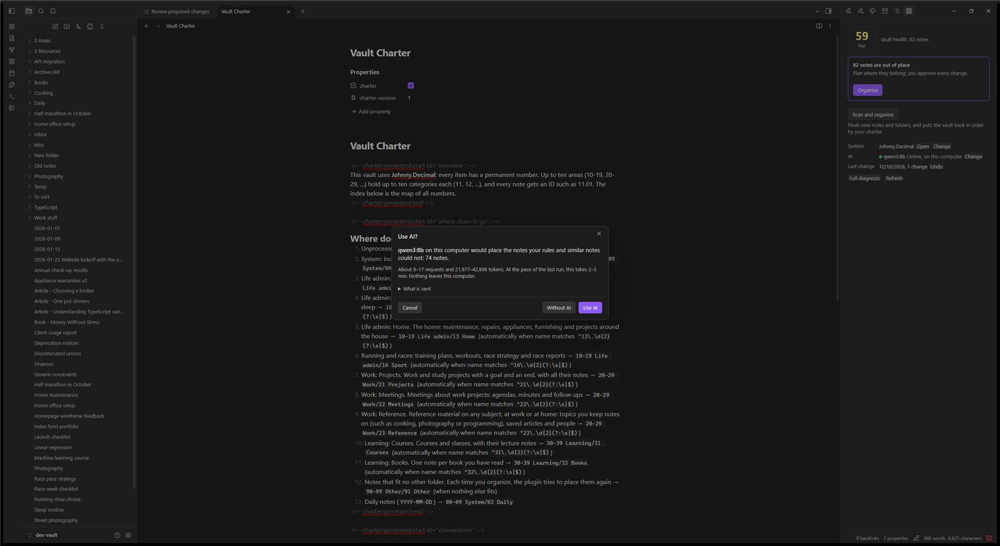
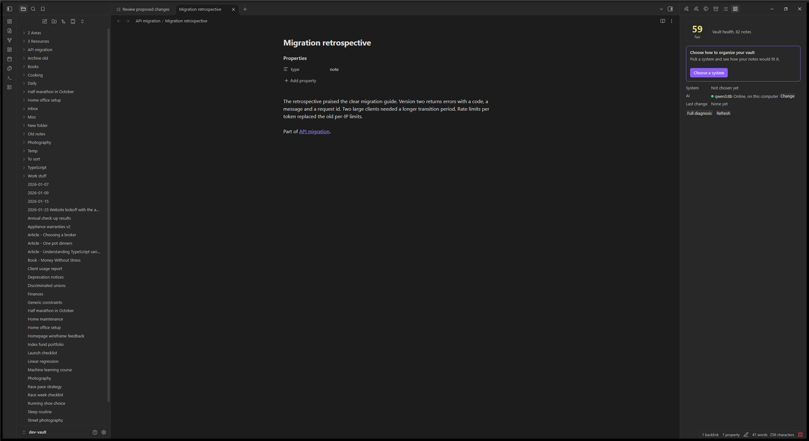
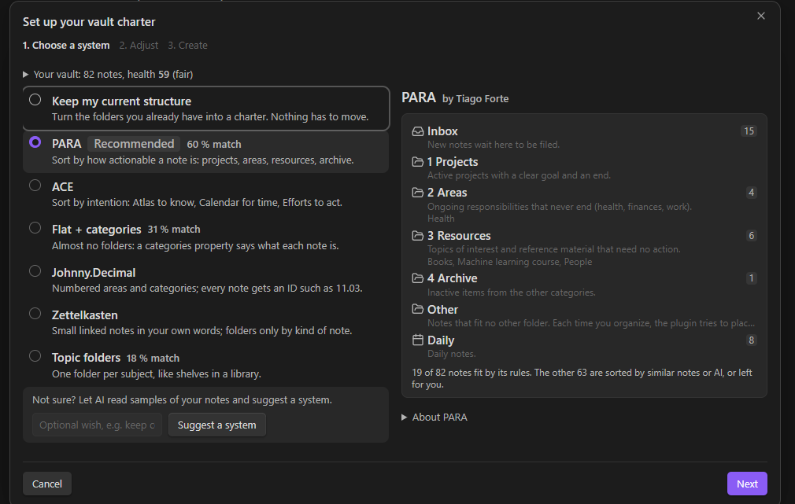
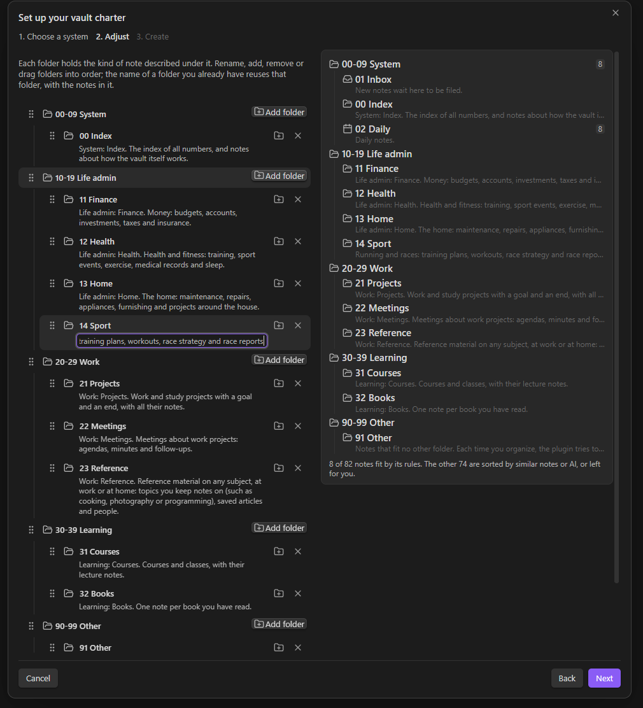
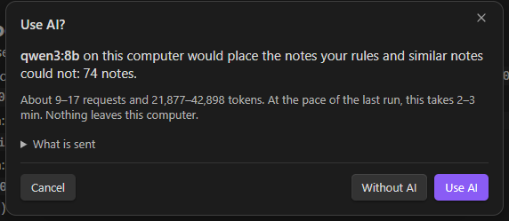
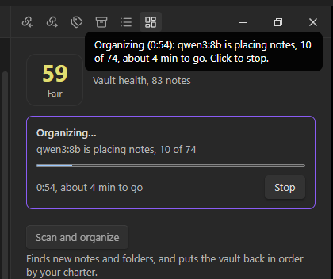
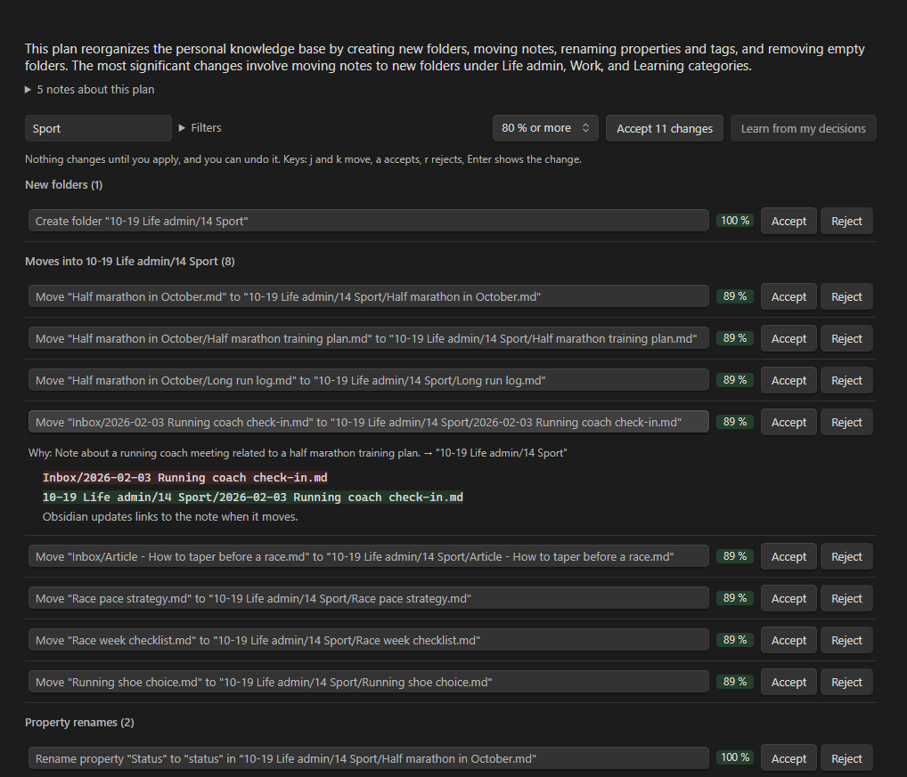
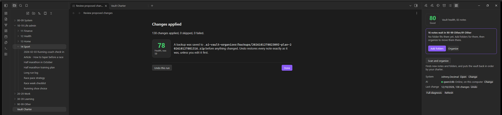

# AI Vault Organizer

**Reorganize a messy Obsidian vault into a system you choose (PARA, Johnny.Decimal, Zettelkasten and
more), and keep it that way.** Rules and AI propose where every note belongs. You approve each change.
No note is ever deleted, and a whole run can be undone.



> [!WARNING]
> **Early development, not yet in Obsidian's community plugins.** It is well tested, but it moves and
> edits your notes. **Back up your whole vault before you use it.** See
> [Before you install](#before-you-install-status-and-risks).

**Read more:** [user guide](docs/USER_GUIDE.md) · [how it works, AI included](docs/HOW_IT_WORKS.md) ·
[the AI and its evaluations](docs/AI_AND_EVALS.md) · [decision records](docs/adr/)

## Contents

- [Why it exists](#why-it-exists)
- [The basic principle](#the-basic-principle)
- [Screenshots](#screenshots)
- [Before you install: status and risks](#before-you-install-status-and-risks)
- [Installation](#installation)
- [Quick start](#quick-start)
- [Safety](#safety) · [Privacy](#privacy) · [AI setup](#ai-setup)
- [For developers](#for-developers) · [License](#license)

## Why it exists

Vaults drift. Notes pile up in the root and in an "Inbox" nobody empties, folders like `Misc`, `Temp` and
`New folder` appear, tags fork into `#WebDev`, `#web-dev` and `#webdev`, and the system you started with
stops matching what is actually there.

Methods such as PARA or Johnny.Decimal help, but moving hundreds of notes into one by hand is slow, and it
risks breaking the links between notes. Existing tools either fix one note at a time or produce a report
you still have to act on.

This plugin wanted to do the whole job, safely:

- show how *your* notes would fit each method before you pick one;
- propose a complete reorganization you can review change by change;
- apply it in a way you can always take back.

It is also a project in practical AI engineering. The model is used only where it adds something, its
answers are checked and calibrated, and every AI feature is measured on test vaults before it ships.

## The basic principle

Think of your vault like infrastructure:

| Idea | In the plugin |
|---|---|
| **Desired state** | The **charter**: a normal note (`Vault Charter.md`) that explains your system in plain words and holds its rules in a small block the plugin reads. |
| **Diff** | The **plan**: every move, new folder, tag fix and folder removal needed to reach the charter, each with a reason and a confidence. |
| **Transaction** | **Apply**: a backup first, then the changes in batches, each written to a journal with how to undo it, and every link checked after each batch. |
| **Monitoring** | **Drift**: the dashboard tells you when notes no longer follow the charter, and organizing again fixes only what changed. |

Where does each note go? A **cascade**, cheapest and most certain first:

1. **Rules** decide what they can: a note named `11.03 …`, a `type: project` property, a note already in
   the right folder. Rules are never wrong.
2. **Similar notes vote**: a note follows the already-placed notes it most resembles, by shared words or,
   with an embedding model, by meaning.
3. **A language model** proposes a place for the rest, only after you agree, and only from your list of
   folders. Unsure answers are asked twice; if the two disagree, the confidence drops.
4. What nothing places for sure waits in an **Other** folder, with the best guess as the reason. Each time
   you organize, those notes get another chance.

**AI proposes, you approve. Nothing is deleted. Everything can be undone.**

## Screenshots

All screenshots are of the synthetic test vault in this repository; no real notes.

**1. A messy vault.** Notes in the root, half-used folders. The dashboard on the right shows the vault's
health and the one next step.



**2. Choose a system.** Every method is shown as the folder tree it would give your notes, with how many
already fit. The one your vault resembles most is recommended.



**3. Adjust it.** Rename, remove, reorder or add folders. Here a `14 Sport` category is added to the
Johnny.Decimal area "Life admin", and the preview updates as you type.



**4. Use AI?** Before anything is sent to a model, you see which model, where it runs, how many notes,
requests and tokens, and how long it should take.



**5. Organizing.** The notice and the dashboard show what is happening, how far along it is, and how long
is left. Stop at any time.



**6. Review the plan.** Changes grouped by kind and destination, each with its reason, its confidence
and an exact preview. Accept or reject them one by one, or everything above a confidence.



**7. The result.** The vault in Johnny.Decimal, with the old folders gone and a report you can undo from.



## Before you install: status and risks

- **Not released yet.** The plugin is not in Obsidian's community plugin directory. Publishing it there is
  planned for the future, after more real-world use and more testing. Until then you install it by hand (below).
- **Tested, but it changes your files.** There are over 700 automated tests, including tests that apply
  random plans to random vaults and check that undo restores every byte, and evaluations on test vaults in
  two languages that check no link breaks. Still, this plugin moves, renames and edits notes, and software
  has bugs.
- **Back up first, every time you try it on a real vault:**
  1. Close Obsidian and copy or zip your **entire vault folder**, hidden folders included. If your vault
     is a git repository, commit instead.
  2. Better still, try it on a **copy** of your vault first.
  3. Pause sync (Obsidian Sync, iCloud, Dropbox, OneDrive) while a plan is applied.
- The plugin's own backup and undo are a second line of defence, not a replacement for yours.
- **Desktop only** (Windows, macOS, Linux), Obsidian 1.11.4 or newer.

## Installation

### From source (the way to install it today)

You need [git](https://git-scm.com) and [Node.js](https://nodejs.org) 22.12 or newer.

```bash
git clone https://github.com/JoseTheChamp/AiVaultOrganizer.git
cd AiVaultOrganizer
npm install
npm run build
```

This creates `main.js`. Then:

1. In your vault, create the folder `.obsidian/plugins/ai-vault-organizer/` (`.obsidian` is hidden; show
   hidden files, or open the vault folder from a terminal).
2. Copy `main.js`, `manifest.json` and `styles.css` from the repository into that folder.
3. In Obsidian, open **Settings → Community plugins**. If community plugins are off, click **Turn on
   community plugins**.
4. Click the reload icon next to **Installed plugins**, then turn on **AI Vault Organizer**.

### From a GitHub release (later)

Each tagged release will have the same three files attached. Download them and copy them into the plugin
folder as in steps 1–4 above.

### From Obsidian's community plugins (planned)

Once published, it will install from **Settings → Community plugins → Browse** like any other plugin.

### Optional: AI on your own computer

Install [Ollama](https://ollama.com), then pull a language model and, for better similarity, an
embedding model:

```bash
ollama pull qwen3:8b
```

```bash
ollama pull bge-m3
```

In Obsidian, run **Set up AI** and choose **On this computer**. Nothing leaves your computer. Cloud models
with your own API key work too; see [AI setup](#ai-setup).

### Updating and removing

- **Update:** build again, copy the three files over the old ones, and turn the plugin off and on.
- **Remove:** turn it off and delete its plugin folder. Its data (backups, the undo journal, caches) lives
  in `.ai-vault-organizer/` in your vault; delete that folder too if you no longer need it.

## Quick start

1. **Open the dashboard** with the ribbon icon or the **Open dashboard** command. It shows the vault's
   health and the one thing to do next.
2. **Set up AI** (optional): on this computer, with your API key, or no AI. A light shows whether the
   model answers.
3. **Choose a system**: the wizard shows each method on your notes. Pick one, adjust its folders, and
   create the charter.
4. **Organize** (or the **Scan and organize** command). If AI is set up, you see what would be sent and
   decide: **Use AI**, **Without AI**, or **Cancel**.
5. **Review** the plan. Start with the least certain changes, accept or reject, or use **Accept N changes**
   for everything above a confidence. Keys: <kbd>j</kbd>/<kbd>k</kbd> move, <kbd>a</kbd> accepts,
   <kbd>r</kbd> rejects, <kbd>Enter</kbd> previews.
6. **Apply.** A backup is made, the changes run, and a report shows what changed, with **Undo this run**.
7. **Later**, the dashboard tells you when notes are out of place or waiting in Other. Add folders for them
   and organize again. **Undo last run** takes back the last change at any time.

The [user guide](docs/USER_GUIDE.md) explains every screen.

## Safety

- **No note is ever deleted.** There is no delete operation for notes or files. "Removing" a note means
  moving it into an archive folder you approved. Folders a plan leaves empty go to the trash only if you
  approve and they are still empty when it runs.
- **You review everything.** Changes are proposals until you apply them.
- **A backup comes first.** Every apply starts with a zip of all notes, canvases and bases in
  `.ai-vault-organizer/backups/` (the last 10 are kept).
- **Links are checked** after every batch; if a link would stop working, the run stops.
- **Undo is exact.** It restores notes byte for byte. Notes you edited after the run are left alone and
  listed, never overwritten.

**Restoring a backup by hand:** each backup zip holds `vault/` (your files) and `manifest.json` (every
file's size and checksum). Close Obsidian, extract the zip and copy the contents of `vault/` over your
vault.

## Privacy

- **No telemetry, no accounts, no servers of ours.** Requests go only to the AI endpoints you configure.
- **Local-only mode is on by default** and blocks any request that would leave your computer.
- **You see what is sent, every time.** Before notes go to a language model, a dialog shows the model, the
  host and the estimated cost. The model gets a short *note card* per note (title, folder, tags, a few
  properties, headings, links and the first few hundred characters), never the whole note.
- **Private notes stay private.** Add `ai-vault-organizer: private` to a note's properties and no AI
  feature will ever send it.
- **API keys** are kept in Obsidian's keychain, never in the plugin's settings.
- Everything the plugin stores (backups, journal, model answers, the similarity index) stays inside your
  vault in `.ai-vault-organizer/`. Exclude it from sync if you prefer.

## AI setup

The plugin works without any AI: rules, drift checks, analysis, review, backup and undo never call a model.

- **A language model** places the notes your rules cannot, names new folders and writes a short summary of
  each plan. Developed and tested with `qwen3:8b` in Ollama. LM Studio, OpenAI, Anthropic, OpenRouter,
  Google Gemini, Mistral, Groq and any OpenAI-compatible endpoint also work.
- **An embedding model** (optional, "Better similarity") compares notes by meaning instead of shared words,
  including across languages. `bge-m3` is a good local choice.

**Set up AI** walks you through it and tests the connection. For a cloud provider, choose your key from
Obsidian's keychain and turn off local-only mode. You can limit parallel requests, requests per minute and
tokens per run, and enter prices to see cost estimates.

## For developers

A pure TypeScript core (`src/core`) with thin Obsidian adapters (`src/obsidian`), a Svelte 5 interface
(`src/ui`) and a Node evaluation suite (`eval/`).

```bash
npm install
npm run dev:vault  # build, and create dev-vault/ from a synthetic test vault with the plugin enabled
npm run dev        # rebuild into dev-vault/ on every change
npm run check      # lint, typecheck and tests (required before every commit)
npm run eval       # evaluations on the test vaults, with recorded model answers
npm run analyze -- <vault-folder>   # the "Analyze vault" diagnostics from the command line
```

Open `dev-vault/` in Obsidian (**Open folder as vault**) to try changes. All test vaults are synthetic.
Commits follow [Conventional Commits](https://www.conventionalcommits.org/); the project's rules are in
[`CLAUDE.md`](CLAUDE.md) and the reasoning behind its design in [`docs/adr/`](docs/adr/).

## License

[MIT](LICENSE), © 2026 Josef Knotek. Developed with AI assistance (Claude Code).
