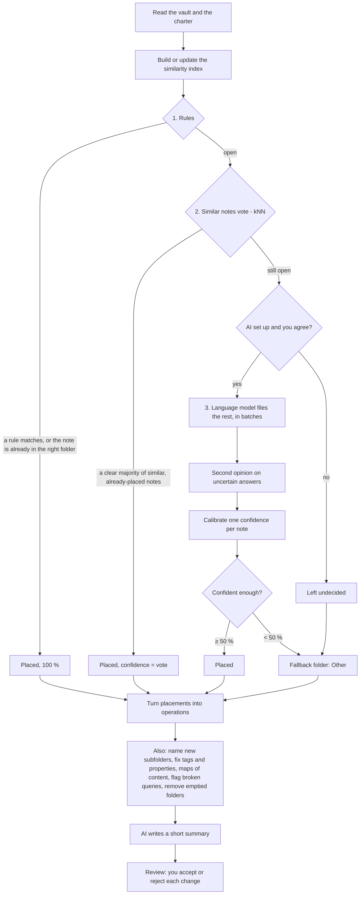

# How AI Vault Organizer works

A walkthrough of the whole plugin for someone new to AI engineering: what it is built with, the rules it
lives by, what happens when you press **Organize**, which parts are ordinary programming and which parts
use AI, and how we know the AI parts work. No code, only how and why.

If you present this project, the short version is in [Presenting it](#presenting-it) at the end.

---

## 1. The problem and the idea

Obsidian is a note-taking app where notes are plain Markdown files in folders (a *vault*). Over time a
vault gets messy: notes in the root, half-used folders, tags spelled three ways, duplicates.

People organize vaults with known methods (**PARA**, **Johnny.Decimal**, **Zettelkasten**, **ACE**,
**Flat + categories**, **Topic folders**), but reorganizing hundreds of notes by hand is tedious and
risky. The plugin does it for you, with one principle:

> **AI proposes, you approve, nothing is ever deleted, everything can be undone.**

The rules of your system live in a normal note, the **charter**: a human-readable description of the
system plus a small machine-readable block that the plugin follows. Everything else follows from the
charter.

---

## 2. What it is built with

| Part | Choice | Why |
|---|---|---|
| Language | **TypeScript** in strict mode | Obsidian plugins run JavaScript; strict types catch mistakes before they reach someone's notes. |
| Platform | **Obsidian plugin API** (desktop only in v1) | Moves go through Obsidian, so links between notes are updated automatically. |
| User interface | **Svelte 5** components | The review screen filters and previews hundreds of changes at once; a reactive UI framework keeps that manageable. Small enough for the bundle budget. |
| Validation | **zod** schemas | Every piece of untrusted data (settings, the charter, *every model answer*) is checked against a schema before use. |
| Build | **esbuild** | One fast bundle, `main.js`, budgeted at 600 kB because Obsidian loads it on every start. |
| Tests | **Vitest**, plus **fast-check** for property-based tests | 684 tests. Property tests generate random vaults and random plans and check that *apply then undo* restores every byte. |
| Other libraries | `yaml` (the charter block), `fflate` (zip backups) | Small and well known; anything over 100 kB needs a good reason. |
| AI models | Any OpenAI-compatible endpoint or Anthropic: **Ollama**, LM Studio, OpenAI, Anthropic, OpenRouter, Google Gemini, Mistral, Groq | *Bring your own model.* Developed and evaluated with **qwen3:8b** (chat) and **bge-m3** (embeddings) running locally in Ollama. |

### Architecture in one picture

```
           ┌─────────────────────────────── core (pure TypeScript) ───────────────────────────────┐
 Obsidian  │  charter · analysis · similarity · planner · AI prompts · apply (validate/backup/... ) │  Node CLI
 adapters ─┤                                                                                       ├─ (evals)
 + Svelte  │                   talks to the outside world only through "ports"                     │
   UI      └───────────────────────────────────────────────────────────────────────────────────────┘
```

This is a **hexagonal architecture** (ports and adapters). All the logic lives in a *core* that never
imports Obsidian. The core describes what it needs as interfaces ("read a note", "move a file", "send an
HTTP request"), and small adapters implement them: one set for Obsidian, one for tests and the
evaluation tool. The payoff: the same planner that runs in the app runs in Node for automated
evaluations, with no Obsidian at all.

---

## 3. The constraints (the rules nothing may break)

These invariants shaped every design decision. They are what makes it safe to let AI near someone's
notes.

1. **No deletion of content.** There is no "delete note" operation at all. "Removing" a note means
   moving it into an archive folder you approved. The only removals: undo may trash files the plugin
   itself created, and a plan may remove *empty* folders, reviewed like any other change, because an
   empty folder holds nothing. (ADR 0002, 0009)
2. **One single write path.** Every change goes *plan → validate → backup → apply → journal → verify*.
   No other code writes to the vault.
3. **The AI never acts on the vault.** A model can only produce *proposals* inside a plan (or a charter
   draft). Every model answer is validated against a schema; a destination the model invents is
   rejected.
4. **The core never imports Obsidian** (see the architecture above).
5. **No telemetry, no servers of ours.** Network calls go only to the endpoints you configured.
   **Local-only mode** (on by default) blocks any request that leaves your computer.
6. **No secrets in the repository.** API keys live in Obsidian's keychain (SecretStorage), never in
   settings files or test recordings.
7. **No real personal notes in the repository.** All test vaults are synthetic.

Obsidian's plugin review adds its own rules, which the code follows: moves only through Obsidian's
link-updating rename, frontmatter edits only through its atomic API, HTTP only through its `requestUrl`,
no `innerHTML`, styles only with Obsidian's theme variables.

---

## 4. The building blocks

### 4.1 The charter

A note called `Vault Charter.md` with two parts:

- **Prose you can read** ("This vault uses Johnny.Decimal… Where does a new note go? …"), generated
  from the rules, plus anything you write yourself.
- **A YAML block the plugin reads**: the method, the *destinations* (folders, or categories in
  Flat + categories), what belongs in each (a sentence in your language), optional automatic *rules*
  (for example "notes named `14.01 …` go to `14 Sport`"), conventions for tags and links, and folders
  the plugin must never touch.

One destination may be the **fallback** (`Other`): where notes go when nothing else fits (ADR 0010).

The **setup wizard** builds the charter. It recommends a method based on your vault, shows each method
as the folder tree it would give *your* notes, and lets you rename, remove and add folders (including
inside a Johnny.Decimal area, numbered for you). It can also ask the AI for a draft (see 6.5).

### 4.2 Analysis (no AI at all)

Before anything moves, the plugin reads the vault and computes, with plain algorithms:

- a **health score** (0–100) from explainable parts: notes in the root, orphans, broken links, tag
  variants, empty folders, folder depth…;
- **which method the vault already resembles**, from folder names, numbering and link density;
- **statistics** such as tag variants (`#WebDev`, `#web-dev`), empty folders and the share of notes
  in the root;
- **stubs and orphans** (near-empty notes, notes nothing links to).

Also built and measured in the evaluations, but **not yet in the app**: near-duplicate detection
(*MinHash*, a fast way to estimate how much two texts overlap, confirmed by titles), clusters of notes
about the same subject, and related-link suggestions.

### 4.3 Similarity: "which notes are like this one?"

Several features need to know which notes are similar. The plugin has two ways to measure it.

**Without an embedding model: word statistics (TF-IDF).**
Every note becomes a list of word counts. *TF-IDF* weighs each word by how often it appears in this note
(term frequency) against how common it is across the whole vault (inverse document frequency): "the" is
worthless, "sourdough" is telling. Two notes are similar when their weighted word lists point the same
way (*cosine similarity*). Words are cut to a short prefix so "running" and "runs" match. This needs no
model, is free, instant and fully local, but it only sees *shared words*.

**With an embedding model (for example bge-m3).**
An *embedding* is a list of numbers (1,024 for bge-m3) that a model computes from a text, placed so that
texts with similar *meaning* get nearby vectors, even with different words ("jog" and "run",
"rozpočet" and "budget"). The plugin:

1. splits each note into heading-aware **chunks**, each starting with the note's title so a fragment
   keeps its context;
2. asks the embedding model for a vector per chunk;
3. averages them, weighted by length, into **one vector per note**, scaled to unit length;
4. stores the vectors in the plugin's folder and **re-embeds only notes whose content changed**
   (checked by a content hash);
5. finds the closest notes by **exact cosine search** (a dot product per note, a few milliseconds for
   thousands of notes), in a background worker so Obsidian never freezes.

Before any text goes to a *cloud* embedding provider, you are asked. Notes marked private are never
sent. If the embedding model is unavailable, the plugin says so and falls back to word statistics.

The **Find similar notes** command shows this directly: the closest notes to the one you are reading.

**Clusters** use the same vectors: dimensionality reduction (PCA) then *k-means* grouping, with the
number of groups chosen automatically (silhouette score). Over TF-IDF this is classic *latent semantic
analysis*. In the app, the charter agent uses word-statistics clusters, described by their keywords, to
see what a vault is about (6.5). The evaluations also measure clusters over embeddings, and a prompt
that names them.

---

## 5. What happens when you press Organize

Organize builds a **plan**: a list of proposed changes. Nothing is changed until you review and apply it.



This is a **cost-aware cascade**: each stage is cheaper and more certain than the next, and only what a
stage cannot decide moves on. Most notes never reach the AI.

### Stage 1: rules (programmatic, certain)

- A charter rule matches (a property `type: project`, a tag, a file name like `14.01 …`): the note goes
  there.
- The note is already inside one of the charter's folders: it stays.
- Daily notes (named by date) go to the daily folder.

On the test vaults rules decide 10–55 % of notes, and they are never wrong.

### Stage 2: similar notes vote, kNN (programmatic, uses similarity)

*k-nearest neighbours*: for an open note, look at the 7 most similar notes that are **already placed**.
If at least 3 of them agree and they carry at least 75 % of the (similarity-weighted) vote, and the
closest one is similar enough, the note follows them, including into the same project subfolder.

- The thresholds are tuned for **precision**: a wrong decision here becomes a proposed move, while
  "I don't know" only costs one AI request later.
- Destinations defined by the *kind* of note (meetings, daily notes, people) never vote: a meeting about
  the website resembles the website project's notes, but it belongs in Meetings.
- kNN only helps where placed notes already exist. In a vault starting a new system, most folders are
  empty, so kNN decides little and the AI does more.

### Stage 3: the language model (AI)

Only if a chat model is set up, and only after a **consent dialog** that names the model and where it
runs, shows exactly what is sent, and estimates requests, tokens, cost (if you set prices) and time (from
the last run's pace). Details in [6.1](#61-classifying-notes-classify-notes).

### Calibration: one honest number per note

Each placement gets a confidence, and the review's "Accept everything at 80 % or more" relies on it.

- Rules: 100 %.
- kNN: its vote share, tempered by how many neighbours voted.
- Model: its own reported confidence is **shrunk toward 50 %** (models are overconfident), then raised
  when kNN agrees and lowered when it disagrees, and **raised a lot when a second sample agrees, lowered
  a lot when it disagrees**. Capped at 95 %; only rules are certain.

The weights were set by hand from evaluations and are checked with **ECE** (expected calibration error:
how far "80 % confident" is from "right 80 % of the time"). See [section 8](#8-how-we-know-it-works).

### The fallback: nothing is left behind

A note no stage could place, or one the AI placed below 50 % (in practice: its two answers disagreed),
goes to the **Other** folder, with the AI's best guess in the reason ("No folder fits for sure, best
guess: 13 Home, 39 %"). Notes in Other are classified again on every run, so when you add a folder that
fits them, they move there. Without a fallback, they are flagged for you instead.

### Everything else the plan does (programmatic)

- **Moves** for every misplaced note, plus the **new folders** they need.
- **Subfolder names** for new projects and topics: the AI proposes names, existing folders are reused
  rather than duplicated ("Web app" next to "Webapp").
- **Normalization**: property names and values (`Type` → `type`), tag spelling (`#Web_Dev` →
  `#web-dev`), as the charter says.
- **Maps of content** (index notes per folder), if enabled.
- **Query checks**: notes with Dataview or Bases queries whose results would change after the moves are
  flagged.
- **Empty folders**: folders the plan empties, and empty folders that are no part of your system, are
  proposed for removal.
- **A summary**: the AI writes two or three sentences on what the plan does, from counts only (it never
  sees your notes for this).

### Review, apply, undo (programmatic, the safety layer)

1. **Review.** Changes grouped by kind and destination, each with *why* and an exact preview (old and new
   path, the lines that change). Accept or reject one by one, by confidence, or with the keyboard.
2. **Validate.** The plan is simulated on a virtual copy of the vault: two notes moved onto one name,
   moves into folders outside the charter, ignored paths and stale notes are all caught before anything
   happens.
3. **Backup.** A zip of all notes, with a checksum per file. No backup, no apply.
4. **Apply** in phases (folders, moves, edits, links, new notes, folder removals) and batches, through
   Obsidian's APIs so links update.
5. **Journal.** Each change is written to an append-only log *with its inverse* before the next starts,
   so even a crash halfway leaves something undoable.
6. **Verify.** After each batch, every link must still point to the same note; otherwise the run stops.
7. **Undo** replays the inverses backwards. It restores a file only if it still has exactly the content
   the run left (checked by hash), so edits you made afterwards are never overwritten. Undo of an
   untouched run is byte-identical, which the property-based tests prove on random vaults.

---

## 6. What the AI actually does

The AI never touches files. There are **six narrow tasks**, each a versioned prompt with a strict answer
schema; four are used in the app today, and two are built and evaluated for later. The output is always
data that goes through review.

| Task (prompt) | When | What the model sees | What it must answer |
|---|---|---|---|
| `classify-notes` v2 | Organize, for notes rules and kNN could not place | Note **cards**, the destinations and their descriptions, example notes, subfolders in use | Per note: reason, destination id **from the list or "abstain"**, subfolder, confidence |
| `subfolder-naming` v1 | Organize, when new project or topic folders would be created | The proposed names and the existing folders | One clean name per group, reusing existing folders |
| `plan-summary` v1 | End of Organize | Counts of changes, notes per destination; **no note content** | Two or three sentences and up to five highlights |
| `charter-agent` v1 | "Suggest a system" in the wizard | Only what its read-only tools return | A complete charter, which must pass validation |
| `cluster-label` v1 | Evaluations only, not yet in the app | Keywords and a few short samples per group | A short name per group, in the vault's language |
| `verify-links` v1 | Evaluations only, not yet in the app | Pairs of short excerpts | Which pairs a careful author would actually link, with a reason |

### 6.1 Classifying notes (`classify-notes`)

This is the core AI task: a **classification** problem with a closed set of labels.

- **Note cards, not notes.** The model sees a compact, deterministic summary: title, folder, tags, a few
  telling properties (such as `type` and `status`), headings, outgoing links, how recently it changed,
  and the first 400 characters. Private notes get no card and are never sent.
- **Batches** of up to 10 notes, sized so every request fits the model's context window (local models
  silently drop the start of a prompt that is too long).
- **The label set is closed.** The answer schema only allows the destination ids shown, or "abstain".
  The model *cannot* invent a folder.
- **Reason first.** The answer starts with a short rationale, then the decision. Writing the reason
  first nudges the model to think before choosing (a light form of chain-of-thought), and the reason is
  shown to you in the review.
- **The descriptions are the real prompt.** Each destination's sentence ("Money: budgets, accounts,
  investments, taxes and insurance") is what the model matches notes against. Improving these
  descriptions raised Johnny.Decimal accuracy from 44 % to 92 % on the English test vault.
- **Second opinion (self-consistency).** Answers in an uncertain band are asked again, in a **different
  batch order**, so the model sees each note in a different context. Agreement is strong evidence;
  disagreement is the best warning sign we have. qwen3:8b reported 0.9 confidence for almost every
  answer, right or wrong, but answers a second sample confirmed were right 92 % of the time, and those
  it contradicted only 34 %.

### 6.2 How a model answer becomes trustworthy data

Language models produce text. Turning that into data the program can rely on takes several layers:

1. **Constrained decoding** where the provider supports it (Ollama, OpenAI): the JSON schema is sent
   with the request, and the model is only allowed to produce tokens that fit it.
2. Otherwise **JSON mode**, with the schema in the prompt.
3. **Validation with zod**, always, even when the provider promised the schema.
4. **One repair round**: if validation fails, the exact errors are sent back and the model gets one more
   try.
5. If it still fails, that batch's notes stay undecided (and go to Other or are flagged). Nothing guesses.

A lesson from the evaluations: under constrained decoding, **optional fields were never written**. The
first prompt had an optional subfolder field, and the model left it out every time. Version 2 made every
field required (nullable instead of optional), which took subfolder accuracy from 13–19 % to 64–81 %.

### 6.3 Thinking models

qwen3 can "think" (reason at length) before answering. For short structured answers that mostly burns
tokens and hit output limits, so thinking is switched off by default for Ollama, with a setting to turn
it on.

### 6.4 Prompts are code

Every prompt lives in its own versioned module with its schema. Changing a prompt means a new version,
an evaluation run and a note on the results. Model answers are cached by a hash of provider, model,
prompt id and version and the full request, so re-running the same plan costs nothing, and any change to a
prompt or its input is automatically a cache miss.

### 6.5 The charter agent: AI with tools

"Suggest a system" uses an **agent**: a loop where the model can call tools, see the results, and decide
what to do next.

- Its tools are **read-only**: a vault overview, method scores, clusters with keywords, sample notes from
  a cluster, the list of presets and one preset in full.
- Its only way to finish is `propose_charter` with a complete charter, which is **validated**. Invalid
  drafts come back with the errors, so the model can fix them.
- It is bounded: at most 8 steps and a token budget. The draft is only shown in the wizard; you decide.

This is the general pattern for safe agents: narrow, read-only tools, a validated final action, hard
limits, and a human in the loop.

### 6.6 Running models: cost, privacy and reliability

- **Consent before sending**, with the model, the host, exactly what is sent, and estimated requests,
  tokens, cost and time.
- **Local-only mode** refuses any non-local request before it is sent; it is enforced in the HTTP layer,
  so no feature can bypass it.
- **A status light** on the dashboard (online, model missing, offline), checked with a request that lists
  models and costs no tokens.
- **Budgets and limits**: a token budget per run, parallel requests, requests per minute.
- **Retries** with exponential backoff for network errors, rate limits and server errors.
- **Progress** you can trust: notes done out of the total, a ticking clock, the time left from the
  measured pace (cached answers are left out of the pace), and Stop.

---

## 7. With and without AI

The plugin is useful at every level. More capability means better results, never a different safety
model.

| Setup | Similarity by | Who places the notes rules could not | What you get |
|---|---|---|---|
| **No models** | Word statistics (TF-IDF) | kNN over word statistics; the rest go to Other (or are flagged) | Charter, analysis, health score, duplicates, clusters, rules, normalization, safe apply and undo. Everything stays on your computer. |
| **Embedding model only** | Meaning (bge-m3 vectors) | kNN over embeddings, which understands synonyms and other languages; the rest go to Other | Placement by similar notes and *Find similar notes* by meaning. No chat model needed. |
| **Chat model only** | Word statistics | kNN over words, then the language model | Every note gets a proposed home; subfolder names; summaries; the charter agent. |
| **Both** (the tested setup) | Embeddings | kNN over embeddings, then the language model with a second opinion | The full cascade and the best calibrated confidences. |

What changes with an embedding model, concretely:

- **kNN understands meaning**, not shared words, so "Race pace strategy" can follow notes about running
  even if they use different words. On the English test vault, kNN over embeddings placed 45 % of notes
  for PARA against 32 % with words, at somewhat lower precision (89 % against 96 %). On the Czech vault
  the two were about even. The test vaults reuse exact sentences, which flatters word statistics.
- **In the evaluations, clusters improve too**: agreement with the true projects rose by 0.04–0.08 ARI on
  every fixture.
- It costs an indexing pass the first time, and later only for notes that changed.

What changes with a chat model:

- Notes rules and kNN cannot place get a proposal with a reason instead of waiting in Other.
- Its answers are checked twice and calibrated, so the confidence you bulk-accept by means something.

---

## 8. How we know it works

AI features are only as good as their measurement. The project treats evaluation as part of the product.

### Synthetic test vaults

Real vaults are private, so the test vaults are generated:

1. **Personas**: Alex, a developer writing in English, and Tereza, an architecture student writing in
   Czech, each with projects, areas, topics, courses, books, people and daily notes.
2. **Generation** builds a clean vault and labels every note with where each method *should* put it
   (the ground truth).
3. **Messify** makes it realistic: stubs, paraphrased duplicates, removed links (kept as held-out links to
   see if the plugin finds them again), drifting property names and tag spellings, notes scattered into
   the root and odd folders, empty folders.

### Tiers and recordings

- **Tier 0** uses no models, **Tier 1** adds embeddings, **Tier 2** adds the language model.
- Model answers are **recorded once** against the local models (*cassettes*) and **replayed** in tests
  and CI. Tests are deterministic, free and offline, and any prompt change shows up as a missing
  recording that has to be re-recorded on purpose.
- Pinned metrics live in `eval/thresholds.json`; CI fails if one regresses.

### What is measured

| Area | Metrics |
|---|---|
| Classification | Accuracy, macro-F1, **ECE**, share and accuracy of answers at 80 % or more, subfolder accuracy, who decided (rules / kNN / model) |
| Links | Precision of the top three suggestions, relevance, recall of removed links |
| Clusters | ARI (agreement with the true projects and topics) |
| Duplicates | Precision and recall |
| Safety | Every operation applied, no broken links, undo byte-exact |

### Current results (qwen3:8b + bge-m3, local)

- Classification accuracy with the full cascade: **74–100 %** depending on method and language (for
  example PARA 89 %, Johnny.Decimal 92 % and ACE 74 % on the English vault).
- Answers at **80 % confidence or more were right 94–100 %** of the time for nine of the ten
  method–language pairs; calibration error (ECE) 0.04–0.13.
- Full plans of up to 434 operations: no broken links, undo always exact.

### What the evaluations taught (the AI-engineering story)

1. **Descriptions beat prompt tricks.** Vague destination descriptions sent notes to the wrong place;
   concrete ones took Johnny.Decimal from 44 % to 92 % and Flat + categories from 79 % to 100 %.
2. **Constrained decoding drops optional fields.** Required, nullable fields fixed subfolders
   (13–19 % → 64–81 %).
3. **A model's self-reported confidence is useless; agreement between two samples is not.** This
   changed the calibration design.
4. **kNN only helps where anchors exist.** Great for a vault already half in PARA, little for a vault
   switching to a new system.
5. **Thinking models need thinking off** for short structured answers.
6. **Honest limits:** the vaults are small (82 notes, so one note is about 1.2 points) and built from
   templated sentences, which flatters word statistics. Compare methods and versions with each other, not
   with real-world expectations.

---

## 9. Where things live

| Folder | What is in it |
|---|---|
| `src/core/charter` | Charter format, presets, validation, the prose generator, wizard changes |
| `src/core/analysis` | Health, method detection, duplicates, clusters, link candidates |
| `src/core/embeddings` | Chunking, TF-IDF, embedding index, cosine search |
| `src/core/planner` | The cascade, note cards, the model stage, calibration, operations |
| `src/core/ai` | Providers, structured output, cache, budgets, retries, local-only guard, prompts, the agent |
| `src/core/apply` | Validation, backup, executor, journal, verification, undo |
| `src/obsidian` | Adapters to Obsidian, commands, flows, views |
| `src/ui` | Svelte components: dashboard, wizard, consent dialog, review |
| `eval/` | Fixture generator, eval runner, cassettes, thresholds |
| `docs/` | Plan, research, decision records (ADRs), user guide, evals |

---

## Presenting it

### The one-minute pitch

"An Obsidian plugin that reorganizes a messy notes vault into a known system like PARA or
Johnny.Decimal. It uses a cost-aware cascade: deterministic rules first, then a nearest-neighbour vote
over embeddings, and only then a language model, which runs locally by default. The model never touches
files: it fills a strict schema, its answers are validated, double-checked and calibrated, and every
change goes through review, a backup, a journal and a byte-exact undo. Quality is measured on synthetic
vaults with recorded model answers, so every prompt change is a measured experiment."

### AI-engineering ideas this project demonstrates

- **Use AI only where it adds value**: a cascade from cheap and certain to expensive and fuzzy.
- **Structured output**: closed label sets, constrained decoding, schema validation, repair rounds.
- **Retrieval-style context**: embeddings, chunking, cosine search, kNN; note cards instead of whole
  notes.
- **Uncertainty**: self-consistency (a second sample), calibration, ECE, a fallback instead of a guess.
- **Agents done safely**: read-only tools, a validated final action, step and token limits, a human in the
  loop.
- **Evaluation-driven development**: synthetic labelled data, recorded model answers, regression
  thresholds in CI.
- **Responsible deployment**: local-first, consent before sending, privacy markers, budgets, no
  telemetry, reversible changes.

### Questions you may get, and short answers

- **Why not just send every note to the AI?** Cost, speed and privacy, and it would be *less* accurate:
  rules are always right and kNN is very precise where it decides. The model handles only what is left.
- **How do you stop the model from hallucinating folders?** The answer schema only accepts the ids it was
  shown, and the answer is validated in code. A made-up folder cannot pass.
- **How do you know the confidence numbers mean anything?** They are calibrated and measured with ECE on
  every evaluation run; answers at 80 % or more were right 94–100 % of the time.
- **What if the model is wrong anyway?** Nothing happens without your review, there is a backup, every
  change is journaled with its inverse, and undo restores the vault byte for byte.
- **Why a local model?** Notes are personal. With Ollama nothing leaves the computer; cloud models work
  too, behind a consent dialog and an off-by-default switch.
- **What would you improve next?** Larger and more varied test vaults, re-filing notes that earlier runs
  put in a wrong category, and comparing more models with the same evaluation suite.

---

## Glossary

- **Embedding**: a vector of numbers representing a text's meaning; similar meanings, nearby vectors.
- **Cosine similarity**: how closely two vectors point the same way, from −1 to 1.
- **TF-IDF**: word weights that favour words frequent in a note but rare in the vault.
- **kNN (k-nearest neighbours)**: decide by looking at the k most similar labelled examples.
- **Chunking**: splitting long text into pieces small enough to embed.
- **Constrained decoding**: limiting a model's output tokens so it can only produce valid JSON for a schema.
- **Self-consistency / second sample**: asking again and trusting answers that agree.
- **Calibration**: making "80 % confident" mean "right about 80 % of the time".
- **ECE (expected calibration error)**: the average gap between stated confidence and actual accuracy.
- **Macro-F1**: accuracy that weighs every destination equally, so small folders count.
- **ARI (adjusted Rand index)**: how well a clustering matches the true groups, 0 = chance, 1 = perfect.
- **Cassette**: a recorded model answer replayed in tests.
- **Agent**: a model in a loop that can call tools and decide its next step.
- **ADR**: architecture decision record, a short document explaining one design decision.
