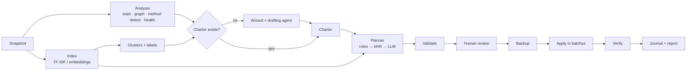

# AI Vault Organizer — Implementation Plan

Status: draft 1 · 2026-10-05 · Maintainer: Josef Knotek · Agent instructions: `CLAUDE.md`

---

## 0. TL;DR

- **What:** an Obsidian plugin that (1) diagnoses a vault, (2) helps choose an organization method
  (PARA, Johnny.Decimal, ACE, Zettelkasten, Flat + categories, Topic folders, or *codify my current structure*),
  (3) writes a **charter** note — a README for the vault that is also machine-readable, (4) builds a
  reviewable **migration plan** (moves, properties, tags, links, MOCs/category notes), applies it after a
  backup with full undo, and (5) later detects **drift** from the charter and plans re-alignment.
- **Mental model:** Terraform / EF migrations for a vault. Charter = desired state, plan = diff,
  apply = transaction (backup, journal, verify, undo), drift = desired vs. actual.
- **AI:** local-first, bring-your-own-model. Three tiers: Tier 0 no AI (rules, graph metrics, TF-IDF),
  Tier 1 embeddings (local or Ollama), Tier 2 LLM (Ollama or the user's own API key). No servers, no
  accounts, zero running cost for the author.
- **Measured quality:** eval harness with synthetic ground-truth vaults (English + Czech), model/tier
  comparison published in the README.
- **Scope v1:** desktop only, Markdown notes only (attachments are never moved), never deletes anything.

## 1. Positioning

The research (`RESEARCH.md` §4) shows "AI vault cleanup" already exists (Note Companion, Vaultend,
Vault Audit AI, Vault Reorganizer). AI Vault Organizer is positioned on what none of them combine:

| Differentiator | Why it matters |
|---|---|
| **Charter as a single source of truth** — readable prose + rules block in one note | The vault explains itself to the user, to future-you, and to any AI agent. Drift is measurable against it. |
| **Method-aware presets** + "codify current structure" | Users pick a known system or keep theirs; the AI works *within* a declared system instead of inventing one per run. |
| **Plan / apply / undo as a transaction** | Backup is mandatory, every op is journaled, link integrity is verified, undo is one command. |
| **Drift loop** | Second and later runs are cheap and incremental; the vault stays organized instead of being reorganized. |
| **Measured AI** | Evals with ground truth per tier and per model. Not "AI vibes". |
| **Free and local by default** | Works with no AI at all; better with Ollama; no account or subscription. |

**Non-goals for v1:** chat with notes, writing assistance, automatic apply without review, mobile,
merging note contents, moving attachments, deleting anything, any hosted service.

## 2. User flows

### 2.1 First run — setup wizard

1. **Diagnose** (Tier 0, seconds): note/folder counts, depth, link density, orphans, root clutter, tag
   variants, property coverage, detected method scores, health score.
2. **Choose method**: the wizard shows the detection result and a recommendation with reasons. With an LLM
   configured, the *charter drafting agent* (§7.7) proposes a preset + customizations based on clusters and
   samples. The user picks: a preset, "codify current structure", or custom.
3. **Customize**: folder names (in the vault's language), which destinations exist, conventions (properties,
   tags, naming, related-links heading, MOCs on/off), ignore globs.
4. **Write the charter**: preview of the charter note → user edits → saved as `Vault Charter.md` (configurable).
5. **Plan**: the planner builds a plan against the charter. Before any LLM call: a **cost & data consent**
   step shows what will be sent where, estimated tokens, and the provider (local or cloud).
6. **Review**: plan review view, grouped by operation type and destination; per-item accept/reject; bulk
   accept above a confidence threshold; diff/preview for every op; warnings (query breakage, conflicts).
7. **Backup → apply → verify**: mandatory zip backup, batched apply with progress and cancel, link-integrity
   verification, run report.
8. **Done**: dashboard shows health score before/after and how to undo.

### 2.2 Maintenance — re-alignment

`Check drift` (Tier 0, cheap, optional on startup) → status bar shows "N notes off-charter" →
`Plan re-alignment` (only new/changed/drifted notes; Tier 1–2 where needed) → review → backup → apply.
If the charter itself changed (version bump), the planner computes the delta between old and new charter.

### 2.3 Single note

`File current note` → classification against the charter → one-op plan → confirm → apply.
`Suggest links for current note` → candidates → accept → links added to the related section.

### 2.4 Undo / restore

`Undo last run` replays the journal's inverse ops in reverse order, skipping (and reporting) ops whose
target changed since apply. Backups are zips in `.ai-vault-organizer/backups/`; manual restore is documented
in the README; a guided restore is on the roadmap.

## 3. The charter

### 3.1 File and format

- One Markdown note at the vault root, default `Vault Charter.md` (configurable).
- Frontmatter: `charter: true` and `charter-version: <int>` (so Bases/Dataview can find it).
- Body: generated human-readable sections + a fenced ` ```charter ` YAML block = the machine rules.
- Generated sections are wrapped in markers so regeneration never clobbers user prose:
  `<!-- charter:generated:start id="overview" -->` … `<!-- charter:generated:end -->`.
  Everything outside markers is user-owned and preserved verbatim.
- The plugin registers a code block processor for `charter` that renders the YAML as a readable card
  (destinations table, conventions, last run) in reading view. Raw YAML stays editable in source mode.

### 3.2 Schema (TypeScript, validated with zod)

```ts
type Charter = {
  version: 1;                       // schema version of the block
  revision: number;                 // bumps on every change; drift compares revisions
  preset: 'para' | 'johnny-decimal' | 'ace' | 'zettelkasten' | 'flat-categories' | 'topics' | 'custom';
  language: string;                 // BCP-47, e.g. 'cs', 'en'; used for prose, labels, folder names
  mode: 'folders' | 'properties' | 'hybrid';
  inbox?: string;                   // folder path
  destinations: Destination[];
  system: { attachments?: string; templates?: string; daily?: { path: string; filename: string } };
  ignore: string[];                 // globs never touched (templates, excalidraw, canvas, etc.)
  conventions: {
    filenames?: { style: 'keep' | 'sentence' | 'title' | 'kebab'; datePrefix?: boolean };
    properties?: { required: string[]; enums?: Record<string, string[]> };
    tags?: { style: 'keep' | 'lowercase-kebab'; nested: boolean; maxPerNote?: number; canonical?: Record<string, string> };
    links?: { relatedHeading: string; minOutgoing?: number };
  };
  mocs?: { enabled: boolean; perDestination: boolean; folder?: string };
  drift?: { inboxMaxAgeDays?: number; checkOnStartup: boolean };
  jd?: { areas: { id: string; name: string; categories: { id: string; name: string }[] }[] }; // Johnny.Decimal index
};

type Destination = {
  id: string;                       // stable key, never shown as a path
  path?: string;                    // folder (folder/hybrid mode)
  category?: string;                // e.g. '[[Books]]' (property mode)
  description: string;              // what belongs here — fed to the classifier verbatim
  layout: 'flat' | 'subfolder-per-item' | 'subfolder-per-topic';
  match?: Rule[];                   // deterministic rules, evaluated before any AI
  examples?: string[];              // paths of anchor notes (few-shot + kNN seeds)
};

type Rule =
  | { property: string; equals: string | string[] }
  | { tag: string }
  | { filename: string }            // regex, e.g. ^\d{4}-\d{2}-\d{2}$ for dailies
  | { pathGlob: string };
```

### 3.3 Example (PARA, Czech vault)

~~~markdown
---
charter: true
charter-version: 3
---
# Vault Charter

<!-- charter:generated:start id="overview" -->
Tento vault používá metodu **PARA**: poznámky třídíme podle toho, jak moc jsou akční…
<!-- charter:generated:end -->

<!-- charter:generated:start id="where-does-it-go" -->
## Kam patří nová poznámka?
1. Nezpracovaný záznam → `0 Inbox`
2. Slouží aktivnímu projektu s cílem a termínem → `1 Projekty/<projekt>`
3. Dlouhodobá odpovědnost bez konce → `2 Oblasti/<oblast>`
4. Téma zájmu nebo referenční materiál → `3 Zdroje/<téma>`
5. Hotové nebo neaktivní → `4 Archiv`
<!-- charter:generated:end -->

## Moje poznámky k systému
(volný text uživatele — plugin ho nikdy nepřepisuje)

```charter
version: 1
revision: 3
preset: para
language: cs
mode: folders
inbox: "0 Inbox"
destinations:
  - id: projects
    path: "1 Projekty"
    description: "Aktivní projekty s jasným cílem a koncem."
    layout: subfolder-per-item
    match: [{ property: type, equals: project }]
  - id: areas
    path: "2 Oblasti"
    description: "Dlouhodobé odpovědnosti, které nekončí (zdraví, finance, práce)."
    layout: subfolder-per-item
  - id: resources
    path: "3 Zdroje"
    description: "Témata zájmu a referenční materiál bez akce."
    layout: subfolder-per-topic
  - id: archive
    path: "4 Archiv"
    description: "Neaktivní věci z ostatních kategorií."
    layout: flat
    match: [{ property: status, equals: [done, archived] }]
system:
  attachments: "Přílohy"
  templates: "Šablony"
  daily: { path: "Deník", filename: "YYYY-MM-DD" }
ignore: ["Šablony/**", "**/*.excalidraw.md"]
conventions:
  properties: { required: [type, created], enums: { type: [project, area, resource, note, daily, meeting] } }
  tags: { style: lowercase-kebab, nested: true, maxPerNote: 5 }
  links: { relatedHeading: "## Související", minOutgoing: 1 }
mocs: { enabled: true, perDestination: true }
drift: { inboxMaxAgeDays: 14, checkOnStartup: true }
```
~~~

### 3.4 Rules

- The YAML block is authoritative. Prose sections are regenerated from it (LLM `charter-prose` prompt, or a
  deterministic template when no LLM is configured).
- Any user edit to the YAML that changes semantics → `revision` bump on next save by the plugin → drift
  detector treats notes as needing re-evaluation against the new revision.
- Invalid YAML never crashes: the code block renders the zod errors with line hints; planner refuses to run.

## 4. Organization presets

Each preset lives in `src/core/charter/presets/<id>.ts` and exports: default destinations (with localized
names for `en` and `cs`), default rules, classifier guidance text, detection signals, and post-apply extras
(MOCs, category notes).

| Preset | Mode | Key destinations | Deterministic rules | What the AI decides |
|---|---|---|---|---|
| **PARA** | folders | Inbox, Projects/*, Areas/*, Resources/*, Archive | `type`/`status` properties, dailies | Project vs Area vs Resource; which project/area/topic subfolder; new subfolder names |
| **Johnny.Decimal** | folders | `NN-NN Area/NN Category/NN.NN Item` | numbers already present; next free ID allocated in code | Which category (enum from the JD index) |
| **ACE** | folders | Atlas (Maps, Notes, Sources, People), Calendar (Daily, Logs, Meetings), Efforts (On/Ongoing/Simmering/Sleeping) | dated filenames → Calendar; maps by link-count heuristic | Knowledge vs time vs action; effort state |
| **Zettelkasten** | hybrid | Fleeting, Literature, Permanent (or flat) | ID filenames; source properties | Note kind; mainly link suggestions and hub notes |
| **Flat + categories** | properties | root, References, Clippings, Daily, Attachments, Templates, Categories | dailies, clippings (source URL property) | `categories` values; generates category notes with an embedded Bases view |
| **Topic folders** | folders | discovered topics (from clustering), shallow tree | — | Topic assignment; topic names from cluster labels |
| **Codify current** | folders/hybrid | existing folders that pass sanity checks | inferred from existing placements | Only new/misplaced notes; existing well-placed notes become anchors |

Flat + categories category note template (Bases syntax must be checked against current Obsidian docs):

~~~markdown
---
categories: []
---
# Books

```base
filters:
  and:
    - categories.contains(link("Books"))
views:
  - type: table
    name: All
```
~~~

## 5. Safety model

### 5.1 Invariants (also in `CLAUDE.md`)

No deletion of user content · single write path · LLM output is data, never action · mandatory backup
before apply · every op journaled with an inverse · verification after every batch.

### 5.2 Operations

```ts
type OpBase = {
  id: string;                        // deterministic hash(kind + target + params) → idempotent plans
  rationale: string;                 // shown in review UI
  confidence: number;                // 0..1, calibrated (§7.6)
  source: 'rule' | 'knn' | 'llm' | 'user';
  status: 'pending' | 'accepted' | 'rejected' | 'applied' | 'skipped' | 'failed';
  dependsOn?: string[];
  precondition?: { path: string; contentHash: string };   // skip if the note changed since planning
};

type Operation = OpBase & (
  | { kind: 'createFolder'; path: string }
  | { kind: 'move'; from: string; to: string }                       // also covers renames
  | { kind: 'setProperty'; path: string; key: string; value: unknown }
  | { kind: 'addTags'; path: string; tags: string[] }
  | { kind: 'replaceTag'; path: string; from: string; to: string }
  | { kind: 'addRelatedLinks'; path: string; targets: string[] }
  | { kind: 'createNote'; path: string; role: 'charter' | 'moc' | 'category'; content: string }
  | { kind: 'updateGeneratedSection'; path: string; sectionId: string; content: string }
  | { kind: 'flag'; path: string; issue: 'orphan' | 'stub' | 'duplicate' | 'query-breakage' | 'ambiguous'; related?: string[] }
);

type Plan = {
  id: string; createdAt: string; charterRevision: number;
  promptVersions: Record<string, number>; models: { chat?: string; embedding?: string };
  operations: Operation[]; warnings: Warning[];
};
```

`flag` never mutates; it surfaces something for the human (e.g. "these two notes look like duplicates").

### 5.3 Validation (before review and again before apply)

No path collisions (two ops moving to the same path, or onto an existing file) · targets inside charter
destinations · nothing inside `ignore` globs · dependency graph is a DAG (folders before moves, moves before
link insertion) · no op touches `.obsidian/` or `.ai-vault-organizer/` · preconditions still hold.

### 5.4 Backup

- Zip via `fflate` (async, non-blocking) into `.ai-vault-organizer/backups/<timestamp>-<planId>.zip`.
- Content: all text files the plan could touch (`.md`, `.canvas`, `.base`) plus `.obsidian/*.json` config.
  Attachments are excluded by default because v1 never modifies them (keeps backups small); option to include.
- `manifest.json` inside the zip: file list with SHA-256 (SubtleCrypto), plugin version, plan id.
- Retention: keep last 10 (configurable). Only the plugin's own backup files are ever pruned.
- Optional external backup folder (desktop) — disclosed in README as "file access outside the vault".
- If the vault is a git repo, the README recommends committing before apply (obsidian-git users).

### 5.5 Apply executor

1. Re-validate plan; check preconditions (content hashes).
2. Check Obsidian's "automatically update internal links" setting (undocumented `vault.getConfig('alwaysUpdateLinks')`,
   guarded); if off, warn and require explicit confirmation. Verification (5.7) is the safety net either way.
3. Phases in order: `createFolder` → `move` → `setProperty`/`addTags`/`replaceTag` → `addRelatedLinks` →
   `createNote`/`updateGeneratedSection`.
4. Batches of ~50 ops; after each batch wait for `metadataCache` `resolved`, then verify; on failure stop,
   offer "undo this run".
5. Cancel button stops after the current batch; partial runs are fully undoable.

Obsidian adapter mapping: `move` → `fileManager.renameFile`; properties/tags → `fileManager.processFrontMatter`;
related links and generated sections → `vault.process` (atomic read-modify-write); `createNote` → `vault.create`.

### 5.6 Journal and undo

- Append-only JSONL `.ai-vault-organizer/journal/<runId>.jsonl`: `{ opId, kind, appliedAt, inverse, beforeHash, afterHash }`.
- Inverses: move ↔ move back; `setProperty` → restore previous value or remove the key; `addTags` → remove
  exactly those tags; `addRelatedLinks` → remove exactly the inserted lines (only if still present);
  `createFolder` → remove if still empty; `createNote` → `fileManager.trashFile` (plugin-created content only).
- Undo checks `afterHash`; if the user edited the note since, the inverse is skipped and reported.

### 5.7 Verification

Snapshot `metadataCache.unresolvedLinks` count and the set of resolved link edges before apply; after each
batch the number of unresolved links must not increase and every pre-existing edge must still resolve
(to the moved path). Violations stop the run.

### 5.8 Query-breakage detection

Before review, scan for folder references that the plan would invalidate: Dataview blocks with
`FROM "<folder>"`, Bases (`.base` files and ` ```base ` blocks) with `file.inFolder("<folder>")` or
`file.folder` comparisons, and Templater/other config paths if cheap to detect. Emit `flag` ops with
`query-breakage` and the exact location. (Auto-rewrite of queries = roadmap.)

## 6. Architecture

### 6.1 Layers (hexagonal)

```
┌────────────────────────── src/obsidian (adapters + UI shell) ─────────────────────────┐
│ main.ts · settings · commands · views (Svelte) · ObsidianVaultAdapter · RequestUrlHttp │
│ SecretStore · ObsidianApplyAdapter · ZipBackup · Worker host                            │
└───────────────▲─────────────────────────────────────────────────────────────▲──────────┘
                │ implements ports                                             │
┌───────────────┴──────────────────────────── src/core ────────────────────────┴──────────┐
│ model · charter (schema, presets, prose) · analysis · embeddings · ai (providers,       │
│ prompts, structured output, budget, cache, agent) · planner · drift · apply (executor,  │
│ journal, undo, verify) · ports.ts                                                        │
└───────────────▲──────────────────────────────────────────────────────────────────────────┘
                │ implements ports
┌───────────────┴──────────── eval/ (Node CLI) ───────────┐
│ NodeFsVaultAdapter · FetchHttp · cassettes · metrics    │
└─────────────────────────────────────────────────────────┘
```

### 6.2 Repository layout

```
.
├── CLAUDE.md
├── README.md  LICENSE  CHANGELOG.md  manifest.json  versions.json  package.json
├── esbuild.config.mjs  tsconfig.json  eslint.config.mts  vitest.config.ts  styles.css
├── .github/  workflows/{ci.yml,release.yml}  pull_request_template.md  ISSUE_TEMPLATE/
├── docs/  PLAN.md  RESEARCH.md  EVALS.md  adr/0001-….md
├── src/
│   ├── core/
│   │   ├── ports.ts               # VaultReader, VaultWriter, Http, Secrets, Storage, Clock, Hasher, Logger
│   │   ├── model/                 # NoteRecord, VaultSnapshot, Operation, Plan, Result
│   │   ├── charter/               # schema, parse/serialize, presets/, prose, codify-current
│   │   ├── analysis/              # stats, graph, method-detect, health, orphans, stubs, duplicates, clustering, ctfidf
│   │   ├── embeddings/            # prepare, chunk, tfidf, store, index, search
│   │   ├── ai/                    # providers/, prompts/, structured.ts, budget.ts, cache.ts, ratelimit.ts, agent/
│   │   ├── planner/               # cards, classify (cascade), calibrate, links, mocs, normalize, query-breakage
│   │   ├── drift/                 # rules engine, run-state, drift report
│   │   └── apply/                 # validate, executor, journal, undo, verify
│   ├── obsidian/                  # main.ts, adapters/, settings/, commands.ts, views/, workers/
│   └── ui/                        # Svelte components (wizard, review, dashboard)
├── eval/  cli.ts  metrics/  generator/  cassettes/  thresholds.json  reports/
└── fixtures/vaults/  en-small/  cs-small/  en-medium/   (synthetic + ground-truth.json)
```

### 6.3 Ports (excerpt)

```ts
interface VaultReader {
  snapshot(opts: { ignore: string[] }): Promise<VaultSnapshot>;   // NoteRecord[] + folders + link graph
  read(path: string): Promise<string>;
}
interface VaultWriter {                                            // used ONLY by the executor
  createFolder(path: string): Promise<void>;
  move(from: string, to: string): Promise<void>;
  processFrontmatter(path: string, fn: (fm: Record<string, unknown>) => void): Promise<void>;
  processBody(path: string, fn: (body: string) => string): Promise<void>;
  create(path: string, content: string): Promise<void>;
  trashPluginCreated(path: string): Promise<void>;
  waitForIndex(): Promise<void>;                                   // metadataCache 'resolved'
}
interface HttpPort { request(req: HttpRequest): Promise<HttpResponse> }   // requestUrl / fetch
interface SecretsPort { get(name: string): Promise<string | null> }
interface StoragePort { read(key: string): Promise<Uint8Array | null>; write(key: string, data: Uint8Array): Promise<void> }
```

`NoteRecord = { path, basename, folder, mtime, size, contentHash, frontmatter, tags, headings, outLinks, inLinks, wordCount, lang? }`.
In Obsidian it is built from `metadataCache`; in Node from a small parser. A **contract test** runs both
adapters over the same fixture and asserts equal snapshots (allowing documented differences).

### 6.4 Pipeline



### 6.5 Where things are stored

| Data | Location |
|---|---|
| Settings | plugin `data.json` (no secrets) |
| API keys | Obsidian SecretStorage (device-local) |
| Embedding/TF-IDF index, LLM cache, run state | `.ai-vault-organizer/cache/` (binary + JSON; dot-folder → not indexed by Obsidian) |
| Journals | `.ai-vault-organizer/journal/` |
| Backups | `.ai-vault-organizer/backups/` (or external folder, opt-in) |
| Pending plan | `.ai-vault-organizer/plans/<id>.json` |

README tells git/obsidian-git and cloud-sync users how to exclude `.ai-vault-organizer/cache/`.

### 6.6 Heavy compute

Similarity search, clustering and (later) local embeddings run in a Web Worker (inlined via an esbuild
plugin, created from a Blob URL) so the UI never freezes. All long jobs report progress and are cancellable.

## 7. AI design (the showcase)

### 7.1 Providers — bring your own model, no servers

| Capability | Default (free) | Alternatives |
|---|---|---|
| Similarity Tier 0 | TF-IDF + BM25-style weighting, in-plugin | — |
| Embeddings Tier 1 | **Ollama** (`bge-m3` or `nomic-embed-text`; multilingual matters for Czech) | OpenAI-compatible embeddings (OpenAI, Gemini, OpenRouter, LM Studio); in-plugin Transformers.js (M11) |
| Chat Tier 2 | **Ollama** local model (on 8 GB VRAM: a ~7–9B instruct model at Q4 — pick by eval results, must support structured output) | Any OpenAI-compatible endpoint (OpenAI, Gemini, OpenRouter, Groq, LM Studio, Mistral) · Anthropic native |

- Two clients cover nearly everything: **OpenAI-compatible** (chat, embeddings, `response_format: json_schema`)
  and **Anthropic** (messages + forced tool use for structured output).
- Each provider declares capabilities: `{ jsonSchema, toolCalling, embeddings, maxContext, local }`.
- Free paths for development: Ollama locally (primary); cloud free tiers only for synthetic evals
  (their terms may allow training on inputs — never send private notes there).
- **Local-only mode** rejects any endpoint whose host is not loopback.
- Keys: SecretStorage by name; settings show which secret is used, never the value.

### 7.2 Note cards — what the model sees

A compact, deterministic representation (≈ 150–400 tokens):
`id, title, current path, selected frontmatter, tags, first 10 headings, excerpt (first ~600 chars of
body, code blocks stripped), up to 10 outgoing link titles, cluster label, age bucket`.
Full note bodies are never sent unless a feature explicitly needs them (e.g. duplicate comparison, shown in consent).

### 7.3 Embeddings and index

- Text prep: strip frontmatter, code blocks, embeds; keep title + headings + body.
- Chunking: heading-aware, ~300–500 tokens, small overlap; note vector = length-weighted mean of chunk
  vectors (normalized). Chunk vectors kept for "why are these similar?" explanations.
- Store: one `Float32Array` per model in a binary file + JSON sidecar `{ path, contentHash, offset, dims, modelId }`.
  Cache key includes `modelId`, so switching models never mixes vectors.
- Incremental: re-embed only notes whose `contentHash` changed. Progress + cancel.
- Search: normalized vectors → dot product; top-k with a min-heap; in a worker.
- Large vaults (> ~3000 notes): restrict candidates to the note's cluster and nearest clusters
  (IVF-style coarse quantization) — explainable ANN without a dependency.

### 7.4 Analysis algorithms (Tier 0/1)

- **Graph:** in/out degree from `resolvedLinks`; orphans (in = 0), dead ends (out = 0), isolated (both).
- **Stubs:** word count below threshold and no links → suggest merge target (nearest neighbor) or inbox.
- **Near-duplicates:** candidates by cosine > 0.92 (Tier 1) or MinHash Jaccard on 5-word shingles (Tier 0),
  confirmed by title similarity; output `flag: duplicate` with both paths (no merging in v1).
- **Clustering:** PCA (power iteration) to 64 dims → k-means++; k chosen by silhouette over a range
  (√n/2 … √n·2, capped); deterministic seed. Small vaults (< 1500) may use agglomerative clustering.
- **Cluster keywords:** class-based TF-IDF (c-TF-IDF) with cs/en stopwords → top terms per cluster.
- **Cluster labels (Tier 2):** LLM names each cluster from keywords + 5 representative cards (closest to centroid).
- **Method detection:** weighted signals per preset (folder name patterns in en/cs, JD numbering regexes,
  dated filenames, root share, `categories` usage, link density) → score per method + "dominant" + "mixed".
- **Health score (0–100):** weighted orphan rate, root clutter, inbox backlog, unresolved links, tag variant
  count, property coverage, empty folders, depth variance. Shown before/after every run.

### 7.5 Link suggestions

1. Candidates: top-k neighbors (k = 8) above a similarity floor, excluding already-linked pairs, the note
   itself, ignored paths, and pairs already suggested and rejected.
2. Tier 0/1: rank by similarity + shared tags + shared neighbors (Adamic–Adar on the link graph).
3. Tier 2 verifier (`verify-links` prompt): batched pairs of cards → `{ pairId, relevant, strength, reason }`.
   Only pairs the model marks relevant survive; reason is shown in review.
4. Insertion: `addRelatedLinks` appends `- [[Target]]` under the charter's related heading (created if
   missing), idempotent (skips links already present anywhere in the note). Inline insertion = roadmap.

### 7.6 Classification — a cost-aware cascade

For each note that the charter says must be placed (initial migration: all non-ignored notes; drift: new,
changed or off-charter notes):

1. **Rules** (deterministic): charter `match` rules, daily filename pattern, system folders. Confidence 1.0.
2. **kNN** (Tier 1): neighbors among *anchor notes* (notes already correctly placed: rule matches,
   `examples`, user-accepted decisions). Vote weighted by similarity. Accept if margin is high.
3. **LLM** (Tier 2) for the rest, batched 8–15 cards per call, `classify-notes` prompt with:
   destination ids and descriptions from the charter, preset guidance, 1–2 anchor examples per destination,
   and a JSON schema whose `destinationId` is an **enum of the charter's destination ids** plus
   `"abstain"` — the model cannot invent folders. Output: `{ noteId, destinationId, subfolder?, confidence, rationale }`.
4. **Abstain → `flag: ambiguous`** for the human, never a guess.

**Calibration:** final confidence combines signals (rule match, kNN margin, LLM self-report, and for
borderline cases a second LLM sample — agreement raises confidence). Measured with ECE in evals; the
review UI's "bulk accept ≥ X" uses calibrated confidence only.

**Human-in-the-loop learning:** accepted/rejected decisions in review become anchors/negative examples;
remaining pending items are re-ranked (kNN) without new LLM calls. Cheap "active learning".

Subfolders for `subfolder-per-item` / `per-topic` layouts: match existing subfolders first; propose new ones
via `subfolder-naming` prompt (normalizes names, prevents near-duplicates like "Web app" vs "Webapp").

### 7.7 Charter drafting agent (tool calling)

A bounded agent loop (max 8 steps, token budget) used in the wizard when an LLM is configured.

Read-only tools over the in-memory analysis:
`get_vault_overview()`, `get_method_scores()`, `list_clusters()`, `get_cluster_samples(clusterId, n)`,
`list_presets()`, `get_preset(id)`, and **`propose_charter(draft)`** which validates the draft with zod
and against the vault (e.g. destinations cover the major clusters, names in the vault language) and
returns errors so the model can self-correct. The loop ends only on a successful `propose_charter` or the
budget; the result is a *draft* shown in the wizard, never written without the user.

### 7.8 Prompt catalog

| Prompt id | Purpose | Output |
|---|---|---|
| `cluster-label` | Name and describe a cluster | `{ label, description }` |
| `verify-links` | Keep only meaningful link pairs | `[{ pairId, relevant, strength, reason }]` |
| `classify-notes` | Place notes into charter destinations | `[{ noteId, destinationId (enum), subfolder?, confidence, rationale }]` |
| `subfolder-naming` | Normalize/propose project/area/topic subfolders | `[{ key, name, reuseExisting? }]` |
| `tag-normalize` | Canonical forms for tag variant groups | `[{ variants, canonical }]` |
| `charter-prose` | Human-readable charter sections in the vault language | `{ sections: [{ id, markdown }] }` |
| `plan-summary` | Short explanation of a plan for the review header | `{ summary, highlights[] }` |
| `charter-agent` | System prompt for the drafting agent | tool calls |
| `summary-judge` | Eval only: check each statement of a plan summary against the plan's facts (ADR 0011) | `[{ id (enum), evidence, verdict }]` |

Each prompt is versioned (`classify-notes.v1.ts`); plans record prompt versions used. Snapshot tests pin
rendered prompts; any change requires a version bump and an eval run.

### 7.9 Structured output strategy

1. Native schema enforcement when the provider supports it (OpenAI-compatible `json_schema`, Ollama
   structured output, Anthropic forced tool use).
2. Fallback: JSON mode + schema in the prompt.
3. Always zod-validate; on failure one **repair** round (send the validation errors back); then give up and
   mark affected items `ambiguous`. Every failure is counted in eval metrics.

### 7.10 Cost, rate limits, caching

- Token estimate before every LLM run (chars/≈4 heuristic + provider tokenizer when available); shown in
  the consent step with the number of calls. Optional user-entered price per 1M tokens → cost estimate
  (no hard-coded prices).
- Hard budget per run; concurrency pool (default 2 local / 4 cloud); token-bucket rate limiter; retry
  with exponential backoff + jitter on 429/5xx, honoring `Retry-After`.
- Content-addressed cache: `hash(promptId, promptVersion, model, input)` → output. Re-running a plan or an
  eval is free. Cache is in `.ai-vault-organizer/cache/llm/`.

### 7.11 Privacy

Consent step lists exactly which data goes to which host. Ignore globs and a per-note
`ai-vault-organizer: private` property exclude notes from any AI processing (they can still be moved by rules).
README discloses all network use as required by the developer policies.

## 8. Evaluation

AI features ship only with measurements: the eval harness shows whether each tier and model actually helps.

### 8.1 Fixtures

- `fixtures/vaults/<name>/` = notes + `ground-truth.json`:
  `{ notes: { [path]: { topic, persona, destinations: { para, ace, jd, flat, topics }, isStub, duplicateOf? } }, trueLinks: [[a,b]], heldOutLinks: [[a,b]] }`.
- **Generation** (`eval/generator/`): personas (e.g. student, software developer, hobby climber/traveller)
  × projects/areas/topics → clean, well-organized notes with known labels. Notes are written by Claude Code
  in-session or by a script against any provider, once; then committed.
- **Messify** (deterministic, seeded): scatter notes into wrong folders and root, remove 30 % of links
  (kept as `heldOutLinks`), add paraphrased duplicates, stubs, tag case/language variants, random empty
  folders, inconsistent property names.
- Sets: `en-small` (~80 notes, CI), `cs-small` (~80 notes, CI, Czech), `en-medium` (~600 notes, local),
  optional generated `en-large` (~5000, perf only).

### 8.2 Metrics

| Area | Metric |
|---|---|
| Classification | accuracy, macro-F1 per preset; abstain rate; **ECE** (calibration); accuracy at confidence ≥ 0.8 |
| Links | precision@k of suggestions vs. `trueLinks ∪ heldOutLinks`; recall of held-out links |
| Clusters | ARI and NMI vs. topic labels |
| Duplicates | precision / recall |
| Safety | broken links after apply (must be 0); undo round-trip identity (must be exact) |
| Cost | LLM calls, tokens in/out, wall time per 100 notes; share of notes decided by rules/kNN/LLM |
| Robustness | structured-output failure rate, repair success rate |

### 8.3 Running

- `npm run eval -- --fixture=cs-small --tier=2 --provider=ollama --model=<name> [--record]`
- Replay mode (default, used in CI) uses cassettes keyed like the LLM cache; no keys, no network, deterministic.
- Output: `eval/reports/<date>-<fixture>-<tier>-<model>.json` + Markdown summary; `docs/EVALS.md` holds the
  methodology and the latest comparison table (Tier 0 vs Tier 1 vs Tier 2; local vs cloud model).
- `eval/thresholds.json`: CI fails if replayed metrics regress beyond thresholds.

## 9. UI and UX

### 9.1 Views and dialogs

- **Dashboard** (right sidebar view): health score, charter status (revision, last run), drift count,
  buttons: Analyze, Set up / edit charter, Plan re-alignment, Undo last run, Open backups.
- **Setup wizard** (modal, steps from §2.1).
- **Plan review** (main-area `ItemView`): header with plan summary and warnings; groups by op kind and
  destination; filters (source, confidence, destination); each row: rationale, confidence badge, preview
  (path diff, frontmatter diff, inserted lines); per-row accept/reject; bulk "accept all ≥ X"; keyboard
  navigation (j/k, a/r) inside the view.
- **Consent & cost** dialog before any LLM run.
- **Apply progress** with cancel; **run report** (counts, verification result, health before/after, undo hint).

### 9.2 Commands (ids without plugin id, no default hotkeys)

`open-dashboard` · `analyze-vault` · `set-up-charter` · `check-drift` · `plan-realignment` ·
`review-pending-plan` · `create-backup` · `undo-last-run` · `file-current-note` · `suggest-links-current-note` ·
`find-similar-notes`

### 9.3 Settings (grouped with `SettingGroup` / headings)

Charter (path, language override) · AI (chat provider, base URL, model, secret; embedding provider/model;
local-only mode; concurrency; budget; optional prices) · Behavior (related heading default, bulk-accept
threshold, check drift on startup) · Privacy (ignore globs, private property name) · Backups (location,
retention, include attachments) · Advanced (debug logging, clear caches).

### 9.4 Copy rules

Sentence case; the plugin always says what it *proposes*, never what it *did* until apply finishes;
every warning has a next action.

## 10. Testing strategy

- **Unit (Vitest)**: all of `src/core`, fast, no network.
- **Property-based (fast-check)**: for random valid plans on random in-memory vaults, `apply` then `undo`
  yields a snapshot identical to the original (hashes); validator rejects all generated collisions.
- **Contract tests**: Obsidian vs Node vault adapters produce equivalent snapshots on fixtures (Obsidian side
  via a recorded snapshot from the dev vault).
- **Integration**: full pipeline on fixtures with cassette providers.
- **Prompt snapshot tests**: rendered prompts pinned per version.
- **Manual QA checklist** (`docs/QA.md`, created in M9) on `dev-vault/` + a copy of a real, long-lived vault.
- **Optional later**: end-to-end UI tests with a WebdriverIO Obsidian service.

## 11. Milestones and commit plan

Each milestone = one branch `m<NN>-<slug>`, one GitHub issue, one PR (merge commit). Commits listed are the
target sequence; each must pass `npm run check`. "DoD" = definition of done.

### M0 — Bootstrap (`m00-bootstrap`)

1. `docs: add project plan, research notes and claude code guide`
2. `build: scaffold plugin with strict typescript and esbuild`
3. `build: configure eslint with typescript-eslint and eslint-plugin-obsidianmd`
4. `test: set up vitest with coverage`
5. `build: add husky, lint-staged and commitlint for conventional commits`
6. `ci: add workflow running lint, typecheck, test and build`
7. `ci: add release workflow attaching plugin assets on version tags`
8. `docs: add readme skeleton, mit license, changelog and github templates`
9. `docs(adr): record hexagonal core with obsidian adapters`
10. `feat(obsidian): add minimal plugin shell with settings tab`

Also (not commits): create GitHub issues for M1–M13, repo description and topics, branch protection on `main`
(require CI). **DoD:** CI green; plugin loads in `dev-vault`; no sample code left.

### M1 — Snapshot and diagnostics (`m01-diagnostics`) — Tier 0 begins

1. `feat(core): define note record, vault snapshot and port interfaces`
2. `test(core): add in-memory vault adapter and tiny fixtures`
3. `feat(eval): add node filesystem vault adapter with markdown parser`
4. `feat(obsidian): build vault snapshot from metadata cache`
5. `test(obsidian): add adapter contract test against fixtures`
6. `feat(analysis): compute vault statistics and link graph metrics`
7. `feat(analysis): detect organization methods with per-method scores`
8. `feat(analysis): compute vault health score`
9. `feat(ui): add analyze vault command with diagnostics modal`

**DoD:** `Analyze vault` works in Obsidian; the same numbers come out of the Node CLI on fixtures.

### M2 — Safety layer (`m02-safety-layer`) — before any AI

1. `feat(core): add operation and plan models with zod schemas`
2. `feat(apply): validate plans for collisions, ignores and dependency order`
3. `feat(core): add content hashing port`
4. `feat(apply): add phased batch executor with preconditions`
5. `feat(apply): add append-only journal with inverse operations`
6. `feat(apply): implement undo from journal with conflict detection`
7. `test(apply): add property-based apply and undo round-trip tests`
8. `feat(apply): verify link integrity after each batch`
9. `feat(obsidian): add apply adapter using file manager and vault.process`
10. `feat(obsidian): create zip backups with manifest`
11. `feat(ui): add create backup and undo last run commands`
12. `docs(adr): record no-delete invariant and plan-apply model`

**DoD:** a hand-written plan applied to the dev vault and undone leaves byte-identical notes (hash check).

### M3 — Charter and rules (`m03-charter`) — usable without AI

1. `feat(charter): add charter schema with yaml parsing and serialization`
2. `feat(charter): add para, johnny.decimal and ace presets`
3. `feat(charter): add zettelkasten, flat-categories and topic presets`
4. `feat(charter): infer a charter from the current folder structure`
5. `feat(charter): generate charter note with preserved user sections`
6. `feat(obsidian): render charter code blocks as a summary card`
7. `feat(drift): add deterministic rule engine`
8. `feat(planner): build rule-only migration plans`
9. `feat(drift): report rule-based drift`
10. `feat(ui): add charter setup without ai and check drift command`
11. `docs(adr): record charter format`

**DoD:** user can create a PARA charter, see drift, plan and apply rule-based moves, and undo.

### M4 — AI provider layer (`m04-providers`)

1. `feat(ai): define chat and embedding provider interfaces with capabilities`
2. `feat(ai): add openai-compatible client for chat, embeddings and json schema`
3. `feat(ai): add anthropic client with forced tool use`
4. `feat(ai): add structured output helper with validation and repair`
5. `feat(ai): add rate limiter, retries with backoff and concurrency pool`
6. `feat(ai): add token estimation and run budget guard`
7. `feat(ai): add content-addressed response cache`
8. `test(ai): add http record and replay cassettes`
9. `feat(ai): enforce local-only mode for non-loopback endpoints`
10. `feat(obsidian): add provider settings with secret storage and connection test`
11. `docs(adr): record bring-your-own-model provider layer`

**DoD:** connection test passes against local Ollama; tests run offline on cassettes; no key in `data.json`.

### M5 — Semantic index (`m05-index`)

1. `feat(embeddings): prepare note text and chunk by headings`
2. `feat(embeddings): add tf-idf vectors as tier 0 similarity`
3. `feat(embeddings): add model-versioned binary vector store`
4. `feat(embeddings): index incrementally by content hash with progress`
5. `feat(embeddings): run top-k cosine search in a web worker`
6. `feat(ui): add find similar notes command`

**DoD:** 600-note fixture indexes with Ollama embeddings; similar-notes results look sane; re-index is incremental.

### M6 — Eval harness (`m06-evals`) — before the AI features it measures

1. `feat(eval): define fixture format with ground truth`
2. `feat(eval): add persona-based fixture generator`
3. `feat(eval): add seeded messify transforms`
4. `test(eval): add en-small and cs-small fixtures`
5. `feat(eval): add cli runner over the node adapter`
6. `feat(eval): add classification, link, cluster, duplicate and cost metrics`
7. `feat(eval): write json and markdown reports`
8. `ci: run replayed evals with regression thresholds`
9. `docs: add eval methodology and tier 0 baseline`

**DoD:** `npm run eval` produces a report; Tier 0 baseline numbers are in `docs/EVALS.md`.

### M7 — Analysis and links (`m07-analysis`)

1. `feat(analysis): triage stubs and orphans`
2. `feat(analysis): detect near-duplicates with minhash and embeddings`
3. `feat(analysis): cluster notes with pca and k-means++`
4. `feat(analysis): extract cluster keywords with c-tf-idf`
5. `feat(ai): label clusters with an llm`
6. `feat(analysis): generate link candidates with cluster-restricted search`
7. `feat(ai): verify link candidates with an llm`
8. `feat(planner): add idempotent related-link operations`
9. `test(eval): measure links, clusters and duplicates per tier`

**DoD:** EVALS.md shows Tier 0/1/2 numbers for links, clusters and duplicates (reported honestly, even if a tier doesn't help).

### M8 — Planner and drafting agent (`m08-planner`)

1. `feat(planner): build compact note cards`
2. `feat(planner): classify notes with a rules, knn and llm cascade`
3. `feat(ai): add enum-constrained classify-notes prompt`
4. `feat(planner): calibrate confidence from combined signals`
5. `feat(planner): name and reuse subfolders for item layouts`
6. `feat(planner): normalize properties and tags`
7. `feat(planner): generate mocs and category notes`
8. `feat(planner): detect queries broken by planned moves`
9. `feat(ai): add charter drafting agent with read-only tools`
10. `feat(ai): summarize plans for review`
11. `test(eval): measure classification and calibration per preset and model`

**DoD:** full plan on `en-medium` and `cs-small`; classification metrics and ECE in EVALS.md.

### M9 — Wizard and review UI (`m09-ui`)

1. `build(ui): add svelte 5 with esbuild-svelte`
2. `feat(ui): add dashboard view`
3. `feat(ui): add setup wizard`
4. `feat(ui): add cost estimate and data consent step`
5. `feat(ui): add plan review view with filters and bulk accept`
6. `feat(ui): show apply progress with cancel and run report`
7. `feat(planner): re-rank pending items from review decisions`
8. `style(ui): use theme variables and improve accessibility`
9. `docs: add qa checklist, screenshots and demo gif`

**DoD:** end-to-end on a copy of a real, long-lived vault, recorded as a GIF for the README.

### M10 — Drift loop (`m10-drift`)

1. `feat(drift): persist run state per charter revision`
2. `feat(drift): detect drift incrementally for new and changed notes`
3. `feat(drift): file inbox notes using the cascade`
4. `feat(drift): replan when the charter revision changes`
5. `feat(ui): add drift status bar item and optional startup check`
6. `feat(ui): add plan realignment and file current note commands`

**DoD:** after a week of normal use, `Check drift` + `Plan re-alignment` keeps the vault on-charter with few LLM calls.

### M11 — In-plugin local embeddings (`m11-local-embeddings`) — spike first

1. `docs(adr): evaluate transformers.js bundling, size and policy compliance`
2. `feat(embeddings): add transformers.js provider in a worker`
3. `test(eval): compare in-plugin, ollama and tf-idf similarity`

**DoD:** either zero-setup local embeddings ship as default, or the ADR documents why not (e.g. bundle
size or the "no downloading code" policy) and TF-IDF/Ollama remain. Both outcomes are fine.

### M12 — Hardening and beta (`m12-beta`)

1. `perf: profile and optimize on a 5000-note synthetic vault`
2. `fix: …` (issues from dogfooding)
3. `docs: complete readme with disclosures, providers guide and evals`
4. `chore(release): 0.9.0`

Beta via BRAT for one–two weeks of daily use. **DoD:** no data-loss bugs; undo verified on real use.

### M13 — Release 1.0 and directory submission (`m13-release`)

1. `chore: verify manifest against submission requirements`
2. `chore(release): 1.0.0`

Then: submit on community.obsidian.md, fix automated findings with patch releases, announce on the forum
(Share & showcase) and Discord.

### Suggested cut lines

- **Core-complete**: M0–M8 + a short demo video. The full AI pipeline works end to end and is measured.
- **Store-ready**: M0–M10 + M12–M13. M11 is optional.
- If time is short: presets PARA, ACE, Flat + categories, Codify current first; JD, Zettelkasten, Topics in 1.1.

## 12. Git and GitHub workflow (summary)

Full rules in `CLAUDE.md`. Highlights: Conventional Commits enforced by commitlint; atomic commits that each
pass CI; branch per milestone; push after every commit; draft PR from the first push; fixups autosquashed
before review; Josef merges with merge commits; bare semver tags trigger the release workflow; issues per
milestone closed by PRs; CHANGELOG updated in each behavior-changing PR.

PR template (`.github/pull_request_template.md`):

```markdown
## Summary
## Why
## Commits
## Design notes  <!-- key idea, tricky parts, trade-offs -->
## How tested
## Eval impact   <!-- metric deltas or "n/a" -->
## Screenshots
## Checklist
- [ ] npm run check passes
- [ ] CHANGELOG updated (if behavior changed)
- [ ] README / ADR / EVALS updated (if relevant)
```

## 13. Release and community directory

- `manifest.json`: `id: ai-vault-organizer`, `name: AI Vault Organizer`, `isDesktopOnly: true`, `minAppVersion: 1.11.4`
  (SecretStorage) or the latest stable if newer APIs are used, no `fundingUrl` unless donations are set up.
  Description (≤ 250 chars, ends with a period): *"Organize your vault with a written charter. Diagnose
  its structure, pick a method like PARA or Johnny.Decimal, review an AI-assisted migration plan, and keep
  notes aligned over time."*
- `versions.json`: plugin version → minAppVersion.
- Release workflow: on tag `x.y.z` → `npm ci && npm run build` → GitHub release with `main.js`,
  `manifest.json`, `styles.css`.
- Before submitting: verify id/name uniqueness in the directory; README disclosures (network use per
  provider, optional external backup folder, no telemetry, no account); LICENSE; screenshots.
- Submit at community.obsidian.md (sign in, link GitHub, add plugin); the automated review reports issues →
  fix → new patch release.
- Announcement post: be explicit — open source, free, no account, AI-assisted development with every module
  reviewed and understood by the author.

## 14. README outline

1. One-line pitch + demo GIF
2. Why (the problem, in two sentences) and how it differs (charter, plan/apply/undo, drift, local-first)
3. How it works (the Terraform mental model + pipeline diagram)
4. Supported methods (table)
5. Safety (never deletes, backups, journal, undo, verification)
6. AI setup — free path (Ollama), BYO keys, local-only mode, tiers
7. Privacy and network use (required disclosures)
8. Evals — results table and link to `docs/EVALS.md`
9. Architecture (short, link to ADRs)
10. Roadmap
11. Development (scripts, contributing)
12. License and AI-assisted development note

## 15. Key technical decisions at a glance

- **Cascade classification** (rules → kNN → LLM): cheapest sufficient method decides; evals report the
  share of decisions per stage, cost and latency.
- **Enum-constrained structured output** + explicit `abstain`: the model can only choose destinations that
  exist in the charter; uncertainty goes to the human.
- **Calibrated confidence** from combined signals instead of raw LLM self-reports (ECE tracked in evals).
- **Embeddings without a vector DB**: multilingual model, heading-aware chunking, mean pooling, cosine on
  normalized vectors, IVF-style candidate restriction for large vaults.
- **Topic discovery without Python**: PCA + k-means++, silhouette-selected k, c-TF-IDF keywords, LLM labels.
- **Bounded agent** for charter drafting: read-only tools, validator exposed as a tool for self-correction,
  step and token budgets.
- **Deterministic evals**: synthetic ground truth, held-out links, record/replay cassettes, CI thresholds.
- **Transactional safety**: no-delete invariant, journal with inverses, link verification, property-based tests.
- **Hexagonal core**: the same core runs inside Obsidian and in the Node eval CLI.
- **Privacy and cost controls**: local-only mode, consent step, budgets, content-addressed caching.

## 16. Roadmap (README only, not v1)

Voice capture → filed by charter · mobile support · proactive morning digest (drift + suggestions in the
daily note) · on-write processing (file and link a note when it's created) · automatic rewrite of broken
Dataview/Bases queries · inline link insertion · guided restore from backup · moving attachments with
their notes · merging duplicates with a diff UI · shared charter templates.

## 17. Risks and open questions

| Risk | Mitigation |
|---|---|
| Transformers.js bundling vs. size and the "no self-installing dependencies" policy | M11 is a spike with an ADR; TF-IDF + Ollama are always available |
| User has "auto-update links" off → moves break links | Pre-check + explicit confirmation; verification aborts and offers undo |
| Sync services (iCloud, Dropbox, Obsidian Sync) racing with bulk moves | Batches + `resolved` waits; README advises pausing third-party sync during apply |
| Small local models give poor structured output | Native schema enforcement, repair round, abstain; evals pick recommended models |
| Czech classification quality | `cs-small` fixture in CI; multilingual embedding model |
| Large vaults (5k+) performance | Worker, incremental index, IVF candidate restriction, perf test in M12 |
| Competition moves faster | The charter + drift + evals angle is hard to bolt on; ship the core-complete cut early |
| Scope creep | Cut lines in §11; roadmap items stay in the README |

**Decisions to confirm with Josef before M0:** final name/id (verify uniqueness), GitHub repo name, MIT
license, default charter filename, keeping Claude Code's co-author trailer on commits, preset order for 1.0.
